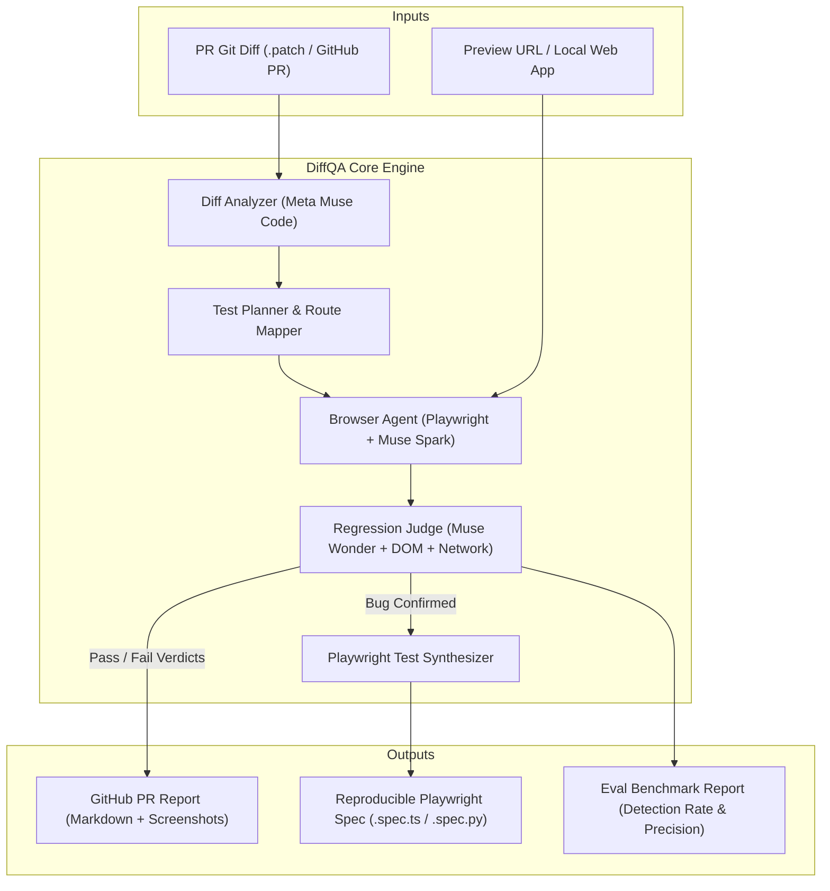

# DiffQA 

> **Autonomous QA Agent that tests web apps like an expert human tester after every PR code change.**  
> Built for the **Meta Global AI Developer Hackathon 2026** (Indie Developer Track).

[](LICENSE)
[](https://www.python.org/)
[](https://playwright.dev/)
[](Dockerfile)
[](https://about.meta.com/)

---

## 🎯 The Problem

When shipping web apps and pull requests:
- **Every pull request requires manual click-through testing**: Engineers or QA spend hours clicking through flows.
- **Regressions slip through**: Traditional scripted E2E tests only cover what someone explicitly remembered to write. If a small CSS tweak breaks a mobile modal or an edge-case form submit throws an uncaught error, CI says "green" while production breaks.

## 💡 What DiffQA Does

**DiffQA bridges the gap between code diffs and live browser testing:**

```
  Git PR Diff  ───┐
                  ├─► [Diff Analyzer] ─► [Flow Planner] ─► [Autonomous Playwright Agent]
  Preview URL  ───┘                                              │
                                                                 ▼
                                                    [Multimodal Bug Oracle]
                                                                 │
                                    ┌────────────────────────────┴───────────────────────────┐
                                    ▼                                                        ▼
                        [Rich PR Markdown Report]                              [Synthesized Playwright Test]
                     (Pass/Fail, Traces, Screenshots)                        (repro-bug-*.spec.ts for CI)
```

1. **Reads the PR Diff**: Uses Meta models (`Muse Code` / `Llama 3.3`) to analyze changed files, routes, components, and state schemas.
2. **Maps User Flows & Edge Cases**: Synthesizes affected routes, primary happy paths, and risk-targeted adversarial paths.
3. **Drives Playwright in Headless Browser**: Navigates the preview URL, perceives interactive DOM elements via Set-of-Marks abstraction, and executes flows.
4. **Multimodal Regression Oracle**: Evaluates DOM state, console logs, network errors (4xx/5xx), visual screenshots, and business invariants.
5. **Generates Reproducible Playwright Tests**: When a bug is caught, DiffQA writes an executable `@playwright/test` script reproducing the exact failure so the bug can never regress.
6. **Posts PR Comment**: Summarizes results with pass/fail badges, repro steps, screenshots, and the committed test spec.

---

## 🏗️ Architecture



---

## 📁 Repository Layout

```tree
DiffQA/
├── diffqa/
│   ├── __init__.py
│   ├── cli.py               # Typer CLI commands (run, scan, eval, serve, demo)
│   ├── config.py            # Environment & model configuration (Pydantic)
│   ├── analyzer/            # PR diff parsing & route/flow mapping
│   │   ├── diff_parser.py   # Unified diff parser & route detector
│   │   └── flow_planner.py  # LLM-driven user flow & edge case planner
│   ├── agent/               # Autonomous Playwright explorer
│   │   ├── browser.py       # Playwright browser lifecycle & page controller
│   │   ├── dom_observer.py  # Interactive element tree & Set-of-Marks tagging
│   │   ├── actions.py       # Action schema & execution (click, fill, navigate)
│   │   └── runner.py        # Autonomous agent loop
│   ├── judge/               # Regression oracles
│   │   ├── oracle.py        # Composite verdict judge & root-cause analysis
│   ├── synthesizer/         # Playwright test generator
│   │   └── test_writer.py   # Generates TypeScript / Python Playwright specs
│   ├── reporter/            # PR Markdown & CI output
│   │   └── markdown.py      # Rich PR comment formatter
│   ├── llm/                 # Unified LLM provider layer
│   │   └── client.py        # Meta Model API, Fireworks, Baseten, Modal, Ollama, Mock
│   ├── pipeline.py          # Shared run → judge → synthesize loop
│   └── benchmark.py         # Applies seeded diffs to the testbed and runs the full pipeline
├── benchmarks/              # Seeded bug evaluation testbed
│   ├── testbed_app/         # QuickShop e-commerce store with SPA routing
│   │   └── index.html
│   ├── scenarios/           # Seeded PR diffs & expected bug catalog
│   │   ├── negative_cart_qty.diff
│   │   ├── broken_promo_uncaught_error.diff
│   │   ├── hidden_checkout_css.diff
│   │   ├── silent_checkout_failure.diff
│   │   └── wrong_total_calculation.diff
│   └── serve.py             # Built-in local HTTP server with SPA routing
├── tests/                   # Unit test suite
│   ├── test_diff_parser.py
│   ├── test_flow_planner.py
│   ├── test_synthesizer.py
│   ├── test_llm_client.py
│   ├── test_judge.py
│   └── test_reporter.py
├── .github/workflows/       # GitHub Actions CI workflow
│   └── diffqa.yml
├── pyproject.toml
├── requirements.txt
├── LICENSE                  # MIT License
└── README.md
```

---

## 🚀 Quickstart

### Prerequisites
- Python 3.10+
- Chromium browser (via Playwright)

### 1. Installation
```bash
# Clone the repository
git clone https://github.com/KathanModh259/DiffQA.git
cd DiffQA

# Install dependencies in editable mode
pip install -e .

# Install Playwright browser
playwright install chromium
```

### 2. Configure Model Provider (Optional for Demo)
Create or edit `.env`:
```env
# Choose provider: "meta", "fireworks", "baseten", "modal", "ollama", or "mock"
DIFFQA_PROVIDER=mock

# When using live Meta or partner API keys:
# MODEL_API_KEY=your_meta_model_api_key
# FIREWORKS_API_KEY=your_fireworks_key
# BASETEN_API_KEY=your_baseten_key
# MODAL_API_KEY=your_modal_key
```
*(`DIFFQA_PROVIDER=mock` runs fully offline: a deterministic agent clicks every visible button once and the judge fails a flow only on hard evidence — uncaught errors, HTTP 5xx, failed actions. Selecting a real provider without its API key is an error, never a silent fallback to mock.)*

---

## 🎮 CLI Usage Cheatsheet

| Command | Description |
| :--- | :--- |
| `diffqa explore <url>` | **Test ANY website autonomously**: navigates to the URL, handles login/SSO barriers (interactive or automated), explores workflows, and synthesizes Playwright tests for bugs found. |
| `diffqa explore <url> --headed` | Runs autonomous exploration with browser window visible. |
| `diffqa explore <url> -u <email> --password <pass>` | Automated login using provided credentials before exploring. |
| `diffqa demo` | **Full end-to-end demo**: serves the testbed with a seeded bug applied (`--scenario`), runs the browser agent against it, and reports what it actually caught. |
| `diffqa demo --headed` | Runs demo with browser window visibly open on screen. |
| `diffqa eval` | Applies every seeded bug diff to the testbed, runs the full pipeline against each, and scores recall plus false positives on a clean baseline. |
| `diffqa scan --diff <file>` | Parses diff and previews planned flows without opening browser. |
| `diffqa run --diff <file> --url <url>` | Runs autonomous QA on any custom PR diff and preview URL. Exits 1 if any flow fails. |
| `diffqa serve --port 3000` | Starts the QuickShop testbed web application locally. |
| `diffqa doctor` | Verifies Python, Chromium, provider credentials and a live model call. Run this first. |
| `diffqa run ... --viewport mobile` | Runs the same flows at a 390×844 phone viewport. |
| `diffqa run ... --base-url https://prod.example.com` | Re-tries each failure on the app before the change. Failures that happen there too are reported as "already broken" and don't fail the run. |
| `diffqa audit <url>` | **Superhuman Invariant Audit**: catches layout overflow, text clipping, broken assets, WCAG a11y violations, and network errors. Generates interactive HTML dashboard. |
| `python -m pytest` | Runs unit tests plus real-browser end-to-end tests (skipped if Chromium is not installed). |

---

## 🌐 Autonomous Exploration on ANY Website (`diffqa explore`)

DiffQA is not limited to git diffs — it can test **any live web application**:

```bash
# 1. Test any public or staging URL:
diffqa explore https://my-app.com --headed

# 2. Test sites with Login / Auth:
# If a login wall is detected, DiffQA opens the browser, pauses, and prompts:
# "Please log in to the web application in the open browser window..."
# Once you log in (via Google, SSO, MFA, or password), DiffQA saves your session
# to `.diffqa_auth.json` and begins autonomous exploratory testing!
diffqa explore https://app.example.com --headed

# 3. Subsequent runs reuse your authenticated session automatically:
diffqa explore https://app.example.com --auth-file .diffqa_auth.json

# 4. Or pass credentials directly for hands-free automated login:
diffqa explore https://app.example.com -u "admin@example.com" --password "Secret123!"
```

---

## 🔍 What DiffQA checks (and what it doesn't)

DiffQA is built to be read like a human tester's report, so every run states what it covered.

**On every step of every flow, without a model:**
- Uncaught JavaScript exceptions and HTTP 5xx responses
- Failed same-origin API calls (4xx on `fetch`/XHR, excluding auth and rate-limit statuses)
- Rendering defects in visible text: `NaN`, `[object Object]`, unrendered `{{ templates }}`
- Suspicious content flagged for the judge: negative amounts, `undefined`/`null`, error-page text
- Every `alert`/`confirm` dialog is captured and read, never silently dismissed
- Page text and the list of visible controls are recorded after each action

**With a model (the judge):**
- Each flow invariant is checked against what the page showed after the relevant step (prices × quantities, totals, counts)
- The goal's expected outcome must have been observed: a missing confirmation, a vanished button, or a silent no-op after submit fails the flow even with clean logs
- The agent can `assert` expected text or a visible control; a failed assertion is hard evidence

**Trust signals in every report:**
- Failed flows are re-run once; the report says **reproduced (2/2)** or **intermittent (1/2)**
- Screenshot at the point of failure, evidence lines, and numbered reproduction steps
- A coverage table: steps taken, assertions made and invariants checked per flow
- Flows DiffQA could not run (preview down, model unavailable) are marked **Not tested**, never reported as app bugs, and still fail CI

**Not covered:** pixel-level visual diffs, flows needing data or accounts the preview can't reach, and anything outside the planned flows. The offline `mock` provider only detects the deterministic checks above.

Run `diffqa doctor` before a demo: it verifies Python, Chromium, credentials and a live model call.

---

## 📊 Evaluation & Benchmark Scorecard

`diffqa eval` applies each seeded bug diff in `benchmarks/scenarios/` to a temporary copy of the testbed, serves it, and runs the real plan → browser agent → judge pipeline. An unpatched baseline run measures false positives.

Offline result with `--provider mock`:
```text
Scenario                       Expected  Detected
baseline_clean                 clean     NO
broken_promo_uncaught_error    bug       YES   (uncaught TypeError on "Apply")
hidden_checkout_css            bug       NO
negative_cart_qty              bug       NO
silent_checkout_failure        bug       NO
wrong_total_calculation        bug       NO

Recall: 1/5 seeded regressions caught
False positives: 0/1 clean runs flagged
```

The mock can only see hard failures. The other four scenarios are invariant bugs (wrong totals, negative quantities, a hidden button, a missing confirmation): catching them requires a real model, which receives the page's final visible text alongside the flow's invariants. Run `diffqa eval --provider meta` (or another provider) to measure that.

Live result with Muse Spark Open on Fireworks (`accounts/fireworks/models/muse-spark-open`):

| Scenario | Result |
|---|---|
| broken_promo_uncaught_error | Caught, reproduced on re-run |
| negative_cart_qty | Caught ("decrement 1→0 leaves a ghost cart item"), reproduced |
| silent_checkout_failure | Caught ("checkout clears cart but never confirms"), reproduced |
| wrong_total_calculation | Caught ("subtotal uses price+qty instead of price×qty"), CRITICAL, reproduced |
| hidden_checkout_css | Caught after the planner fix below, reproduced |
| baseline_clean | No false positives after the fixes below |

How we got there, honestly: the first full live run caught 4/5 and flagged the clean store. That flag was a real bug in the demo store (checkout never emptied the cart), which we fixed. The live runs also exposed three DiffQA faults, each now fixed and covered by a test: the planner treated the diff as the spec ("verify the button is hidden"), the agent navigated to made-up URLs, and a pre-existing quirk was blamed on the change. The hidden-checkout and clean-baseline rows come from targeted re-runs after those fixes, not from one single end-to-end run.

---

## 🧪 Auto-Generated Playwright Test Example

When DiffQA catches a regression during PR inspection, it immediately generates a clean, committed Playwright test:

```typescript
import { test, expect } from '@playwright/test';

/**
 * DiffQA auto-generated regression test
 * Flow: Click through every visible control
 * Bug: Errors observed during flow execution
 * Severity: HIGH
 */
test.describe("DiffQA Regressions: flow-smoke-click-through", () => {
  test("reproduce: Errors observed during flow execution", async ({ page }) => {
    await page.goto("http://127.0.0.1:3000/");

    // Step 1: Clicking unexplored button [btn-add-to-cart-1].
    await page.locator("#btn-add-to-cart-1").click();
    await page.waitForTimeout(300);

    // Step 5: Clicking unexplored button [btn-apply-promo].
    await page.locator("#btn-apply-promo").click();
    await page.waitForTimeout(300);

    // Invariant: No uncaught JavaScript exceptions
    await expect(page.locator('body')).not.toContainText('Internal Server Error');
  });
});
```

---

## 🤖 Meta Models Integration

DiffQA calls the [Meta Model API](https://dev.meta.ai/docs) (`https://api.meta.ai/v1/chat/completions`, OpenAI-compatible) with your `MODEL_API_KEY`.

| Pipeline Stage | Default model | Setting | Role |
| :--- | :--- | :--- | :--- |
| **Flow Planner** | `muse-spark-1.3` | `DIFFQA_CODE_MODEL` | Reads the diff and designs happy-path and adversarial journeys with invariants. |
| **Browser Agent** | `muse-spark-1.3` | `DIFFQA_AGENT_MODEL` | Picks each next action from the live page's interactive elements. |
| **Regression Judge** | `muse-spark-1.3` | `DIFFQA_JUDGE_MODEL` | Checks invariants against the final page text, errors and network failures. |

Other OpenAI-compatible hosts (Fireworks, Baseten, Modal serving Muse Spark Open) and local Ollama work via `--provider`; set the three model variables to that host's model IDs.

**Reliability:** rate limits (429), 5xx and network errors are retried with exponential backoff; a reply that isn't JSON gets one repair request; loosely formatted model output (`"severity": "high"`, `"action": "type"`) is normalised rather than rejected. If DiffQA can't test a flow (preview unreachable, model down) the flow is reported as **Not tested**, never as an app bug, and the run still fails so CI stays red.

### CI setup
Add the repository secret `MODEL_API_KEY` and the variable `DIFFQA_PREVIEW_URL` (your PR preview deployment). [`.github/workflows/diffqa.yml`](.github/workflows/diffqa.yml) then runs on every PR, comments the report, uploads screenshots/specs, and fails the check on regressions. Optionally set the variable `DIFFQA_BASE_URL` to your production or main-branch deployment, so bugs that were already there are labelled "already broken" instead of failing the PR.

--- | :--- | :--- |
| **Diff & AST Analysis** | `meta/muse-code` / `Llama-3.3-70B` | Reads code diffs, identifies modified endpoints/components, and designs happy/adversarial test journeys. |
| **Browser Exploration Agent** | `meta/muse-spark` / `Llama-3.2-Vision` | Closed action-perception loop driving Playwright via structured DOM observation. |
| **Regression Judge / Oracle** | `meta/muse-wonder` / `Llama-3.2-Vision` | Multi-signal evaluation: DOM invariants, visual layout breakage, uncaught exceptions, and 500 status codes. |
| **Inference Partners** | Fireworks, Baseten, Modal | Low-latency inference endpoints & serverless sandboxes. |

---

## 🏆 Hackathon Details
- **Participant:** Kathan Modh ([LinkedIn](https://www.linkedin.com/in/kathanmodh/) | [GitHub](https://github.com/KathanModh259))
- **Track:** Indie Developer Track ($1M prize pool)
- **Event:** [Meta Global AI Developer Hackathon](https://cerebralvalley.ai/e/meta-ai-developer-hackathon/details) (Oct 26 – Nov 4, 2026)

---

## 📄 License

This project is licensed under the MIT License — see the [LICENSE](LICENSE) file for details.
