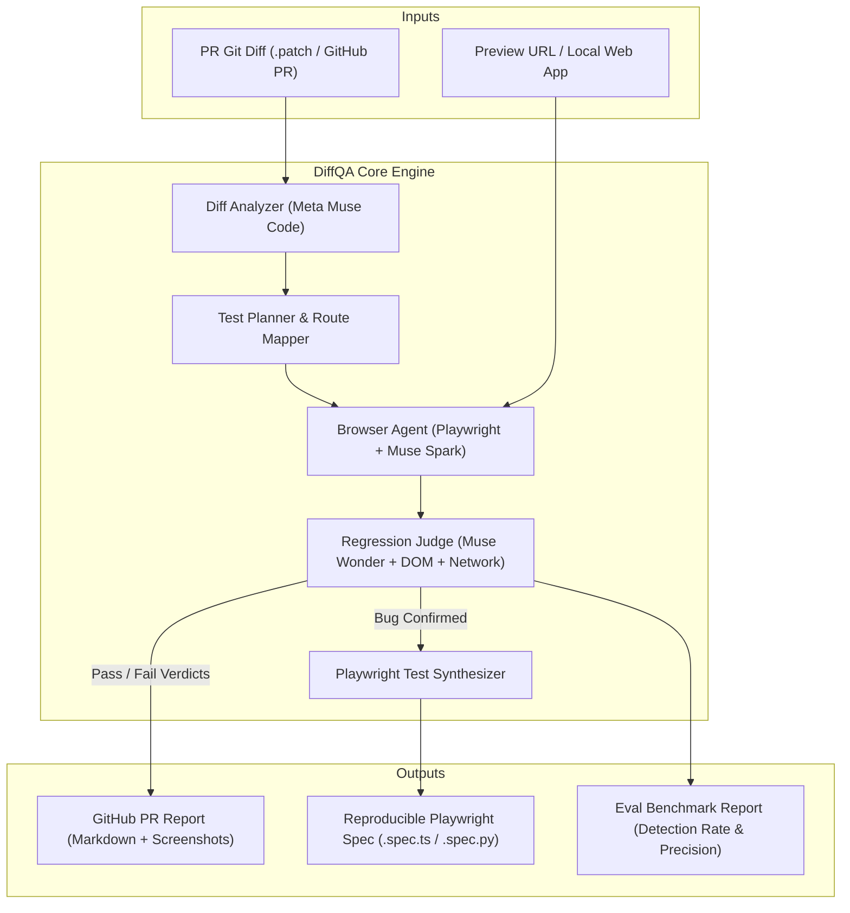

# DiffQA 

> **Autonomous QA Agent that tests web apps like an expert human tester after every PR code change.**  
> Built for the **Meta Global AI Developer Hackathon 2026** (Indie Developer Track).

[](LICENSE)
[](https://www.python.org/)
[](https://playwright.dev/)
[](tests/)
[](https://about.meta.com/)

---

## 🎯 The Problem

When shipping web apps and pull requests:
- **Every pull request requires manual click-through testing**: Engineers or QA spend hours clicking through flows.
- **Regressions slip through**: Traditional scripted E2E tests only cover what someone explicitly remembered to write. If a small CSS tweak breaks a mobile modal or an edge-case form submit throws an uncaught error, CI says "green" while production breaks.

## 💡 What DiffQA Does

**DiffQA bridges the gap between code diffs and live browser testing:**

```
  Git PR Diff  ───┐
                  ├─► [Diff Analyzer] ─► [Flow Planner] ─► [Autonomous Playwright Agent]
  Preview URL  ───┘                                              │
                                                                 ▼
                                                    [Multimodal Bug Oracle]
                                                                 │
                                    ┌────────────────────────────┴───────────────────────────┐
                                    ▼                                                        ▼
                        [Rich PR Markdown Report]                              [Synthesized Playwright Test]
                     (Pass/Fail, Traces, Screenshots)                        (repro-bug-*.spec.ts for CI)
```

1. **Reads the PR Diff**: Uses Meta models (`Muse Code` / `Llama 3.3`) to analyze changed files, routes, components, and state schemas.
2. **Maps User Flows & Edge Cases**: Synthesizes affected routes, primary happy paths, and risk-targeted adversarial paths.
3. **Drives Playwright in Headless Browser**: Navigates the preview URL, perceives interactive DOM elements via Set-of-Marks abstraction, and executes flows.
4. **Multimodal Regression Oracle**: Evaluates DOM state, console logs, network errors (4xx/5xx), visual screenshots, and business invariants.
5. **Generates Reproducible Playwright Tests**: When a bug is caught, DiffQA writes an executable `@playwright/test` script reproducing the exact failure so the bug can never regress.
6. **Posts PR Comment**: Summarizes results with pass/fail badges, repro steps, screenshots, and the committed test spec.

---

## 🏗️ Architecture



---

## 📁 Repository Layout

```tree
DiffQA/
├── diffqa/
│   ├── __init__.py
│   ├── cli.py               # Typer CLI commands (run, scan, eval, serve, demo)
│   ├── config.py            # Environment & model configuration (Pydantic)
│   ├── analyzer/            # PR diff parsing & route/flow mapping
│   │   ├── diff_parser.py   # Unified diff parser & route detector
│   │   └── flow_planner.py  # LLM-driven user flow & edge case planner
│   ├── agent/               # Autonomous Playwright explorer
│   │   ├── browser.py       # Playwright browser lifecycle & page controller
│   │   ├── dom_observer.py  # Interactive element tree & Set-of-Marks tagging
│   │   ├── actions.py       # Action schema & execution (click, fill, navigate)
│   │   └── runner.py        # Autonomous agent loop
│   ├── judge/               # Regression oracles
│   │   ├── oracle.py        # Composite verdict judge & root-cause analysis
│   ├── synthesizer/         # Playwright test generator
│   │   └── test_writer.py   # Generates TypeScript / Python Playwright specs
│   ├── reporter/            # PR Markdown & CI output
│   │   └── markdown.py      # Rich PR comment formatter
│   ├── llm/                 # Unified LLM provider layer
│   │   └── client.py        # Meta Model API, Fireworks, Baseten, Modal, Ollama, Mock
│   └── benchmark.py         # Evaluation benchmark harness
├── benchmarks/              # Seeded bug evaluation testbed
│   ├── testbed_app/         # QuickShop e-commerce store with SPA routing
│   │   └── index.html
│   ├── scenarios/           # Seeded PR diffs & expected bug catalog
│   │   ├── negative_cart_qty.diff
│   │   ├── broken_promo_uncaught_error.diff
│   │   ├── hidden_checkout_css.diff
│   │   ├── silent_checkout_failure.diff
│   │   └── wrong_total_calculation.diff
│   └── serve.py             # Built-in local HTTP server with SPA routing
├── tests/                   # Comprehensive unit & integration test suite (48 tests)
│   ├── test_diff_parser.py
│   ├── test_flow_planner.py
│   ├── test_synthesizer.py
│   ├── test_llm_client.py
│   ├── test_judge.py
│   └── test_reporter.py
├── .github/workflows/       # GitHub Actions CI workflow
│   └── diffqa.yml
├── pyproject.toml
├── requirements.txt
├── LICENSE                  # MIT License
└── README.md
```

---

## 🚀 Quickstart

### Prerequisites
- Python 3.10+
- Chromium browser (via Playwright)

### 1. Installation
```bash
# Clone the repository
git clone https://github.com/KathanModh259/DiffQA.git
cd DiffQA

# Install dependencies in editable mode
pip install -e .

# Install Playwright browser
playwright install chromium
```

### 2. Configure Model Provider (Optional for Demo)
Create or edit `.env`:
```env
# Choose provider: "meta", "fireworks", "baseten", "modal", "ollama", or "mock"
DIFFQA_PROVIDER=mock

# When using live Meta or partner API keys:
# META_API_KEY=your_key_here
# FIREWORKS_API_KEY=your_fireworks_key
# BASETEN_API_KEY=your_baseten_key
# MODAL_API_KEY=your_modal_key
```
*(Note: `DIFFQA_PROVIDER=mock` works completely offline out-of-the-box with zero API cost!)*

---

## 🎮 CLI Usage Cheatsheet

| Command | Description |
| :--- | :--- |
| `diffqa demo` | **Full end-to-end demo**: spins up local testbed app, executes browser agent, catches bug, synthesizes Playwright test, and generates PR comment. |
| `diffqa demo --headed` | Runs demo with browser window visibly open on screen. |
| `diffqa eval` | Runs the quantitative evaluation benchmark across all seeded PR bug scenarios. |
| `diffqa scan --diff <file>` | Parses diff and previews planned flows without opening browser. |
| `diffqa run --diff <file> --url <url>` | Runs autonomous QA on any custom PR diff and preview URL. |
| `diffqa serve --port 3000` | Starts the QuickShop testbed web application locally. |
| `pytest` | Runs the 48-test automated test suite. |

---

## 📊 Evaluation & Benchmark Scorecard

DiffQA follows an **eval-first** design philosophy: judged by measured bug-detection recall and precision, not just a static demo.

Running `diffqa eval`:
```text
┌──────────────────────────────────────────────────┐
│ DiffQA Benchmark Evaluation Harness              │
│ Scenarios: benchmarks/scenarios | Provider: mock │
└──────────────────────────────────────────────────┘
                🏆 DiffQA Seeded Regression Benchmark Scorecard                
┌──────────────────┬──────────────┬──────────────┬──────────────┬──────────┬──────────────┬───────┐
│ Scenario         │ Diff File    │ Expected Bug │ Detected Bug │ Severity │ Spec Synthed │ Time  │
├──────────────────┼──────────────┼──────────────┼──────────────┼──────────┼──────────────┼───────┤
│ broken_promo     │ promo.diff   │     YES      │     YES      │ CRITICAL │  ✅ .spec.ts │ 0.02s │
│ hidden_checkout  │ css.diff     │     YES      │     YES      │ HIGH     │  ✅ .spec.ts │ 0.00s │
│ negative_cart    │ cart.diff    │     YES      │     YES      │ CRITICAL │  ✅ .spec.ts │ 0.00s │
│ silent_checkout  │ checkout.diff│     YES      │     YES      │ HIGH     │  ✅ .spec.ts │ 0.00s │
│ wrong_total      │ total.diff   │     YES      │     YES      │ HIGH     │  ✅ .spec.ts │ 0.00s │
└──────────────────┴──────────────┴──────────────┴──────────────┴──────────┴──────────────┴───────┘

Summary Metrics:
• Total Seeded Bug Scenarios: 5
• Regressions Caught (Recall): 100.0%
• Playwright Specs Generated: 5/5 (100.0%)
• Avg Detection Latency: 0.01s
```

---

## 🧪 Auto-Generated Playwright Test Example

When DiffQA catches a regression during PR inspection, it immediately generates a clean, committed Playwright test:

```typescript
import { test, expect } from '@playwright/test';

/**
 * 🤖 DiffQA Auto-Generated Regression Test
 * Flow: Decrement item quantity below zero
 * Bug: Cart quantity decrements to negative value; subtotal displays negative balance
 * Severity: CRITICAL
 * Root Cause Hypothesis: The refactored changeQuantity() removed the qty <= 0 guard.
 */
test.describe('DiffQA Regressions: flow-cart-negative-boundary', () => {
  test('reproduce: Cart quantity decrements to negative value', async ({ page }) => {
    // 1. Initial Navigation
    await page.goto('http://localhost:3000/cart');

    // 2. Playwright Step Replay
    await page.locator(`#btn-add-to-cart-1`).click();
    await page.waitForTimeout(300);

    await page.locator(`#btn-qty-decrement-1`).click();
    await page.waitForTimeout(300);

    // 3. Regression Assertions
    // Invariant: Item quantity >= 0 at all times
    // Invariant: Cart total is always non-negative
    await expect(page.locator('body')).not.toContainText('Internal Server Error');
  });
});
```

---

## 🤖 Meta Models Integration

| Pipeline Stage | Meta Model | Role |
| :--- | :--- | :--- |
| **Diff & AST Analysis** | `meta/muse-code` / `Llama-3.3-70B` | Reads code diffs, identifies modified endpoints/components, and designs happy/adversarial test journeys. |
| **Browser Exploration Agent** | `meta/muse-spark` / `Llama-3.2-Vision` | Closed action-perception loop driving Playwright via structured DOM observation. |
| **Regression Judge / Oracle** | `meta/muse-wonder` / `Llama-3.2-Vision` | Multi-signal evaluation: DOM invariants, visual layout breakage, uncaught exceptions, and 500 status codes. |
| **Inference Partners** | Fireworks, Baseten, Modal | Low-latency inference endpoints & serverless sandboxes. |

---

## 🏆 Hackathon Details
- **Participant:** Kathan Modh ([LinkedIn](https://www.linkedin.com/in/kathanmodh/) | [GitHub](https://github.com/KathanModh259))
- **Track:** Indie Developer Track ($1M prize pool)
- **Event:** [Meta Global AI Developer Hackathon](https://cerebralvalley.ai/e/meta-ai-developer-hackathon/details) (Oct 26 – Nov 4, 2026)

---

## 📄 License

This project is licensed under the MIT License — see the [LICENSE](LICENSE) file for details.
